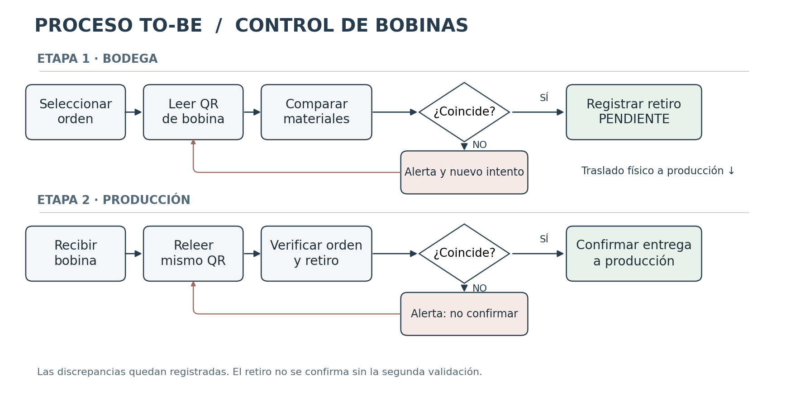

# 02. Proceso actual, proceso propuesto y automatización

## 1. AS-IS: síntesis de Entrega 1

La Entrega 1 identifica la transferencia de materiales desde bodega a impresión como punto vulnerable. La orden informa qué materia prima se requiere; el operario de bodega entrega la bobina y producción continúa el trabajo. El informe original incluye diagramas AS-IS y TO-BE en su anexo (p. 16). El riesgo se produce cuando el material entregado no se confronta de forma obligatoria con la orden y la diferencia se descubre después.

## 2. TO-BE: cambios introducidos en E2

El archivo editable `assets/bpmn-to-be.bpmn` conserva el diagrama BPMN 2.0. La figura superior resume el mismo flujo en un formato apto para informe y exposición.

| Paso | Responsable | Acción | Evidencia |
|---|---|---|---|
| 1 | Bodega | Selecciona orden y presenta bobina | `ordenes_produccion`, `bobinas` |
| 2 | Sistema | Comprueba coincidencia entre material de bobina y orden | `validaciones`, etapa BODEGA |
| 3a | Sistema | Si hay diferencia, registra alerta e impide el retiro | `NO_COINCIDE`, sin nueva fila en `retiros` |
| 3b | Sistema | Si coincide, autoriza retiro pendiente | `retiros` y estado RESERVADA |
| 4 | Producción | Recibe y vuelve a leer el mismo QR | `validaciones`, etapa PRODUCCION |
| 5a | Sistema | Si no corresponde, conserva retiro pendiente | Alerta y prohibición de confirmación |
| 5b | Sistema | Si corresponde, confirma entrega | `retiros.CONFIRMADO`, `bobinas.ENTREGADA` |

## 3. Relación con el proceso y la base de datos

Las actividades de comparación, registro de eventos y cambio de estado no quedan a criterio del usuario: se ejecutan en transacciones y con restricciones SQL. El escenario de rechazo mantiene trazabilidad de la discrepancia, aun cuando no exista un retiro autorizado. La segunda lectura distingue la preparación del material de su recepción efectiva.

La mejora también introduce un criterio que el TO-BE preliminar no precisaba: una bobina reservada o entregada no puede volver a ser retirada. En cambio, una misma orden puede requerir distintas bobinas, manteniendo un registro separado por transferencia.

## 4. Límites del modelo

El BPMN se concentra en la operación crítica: selección, transferencia y confirmación. No representa consumos parciales, devoluciones, modificación de órdenes, impresión ni despacho. El hecho de que el flujo termine con «entrega confirmada» no significa que la producción ya se haya realizado.
