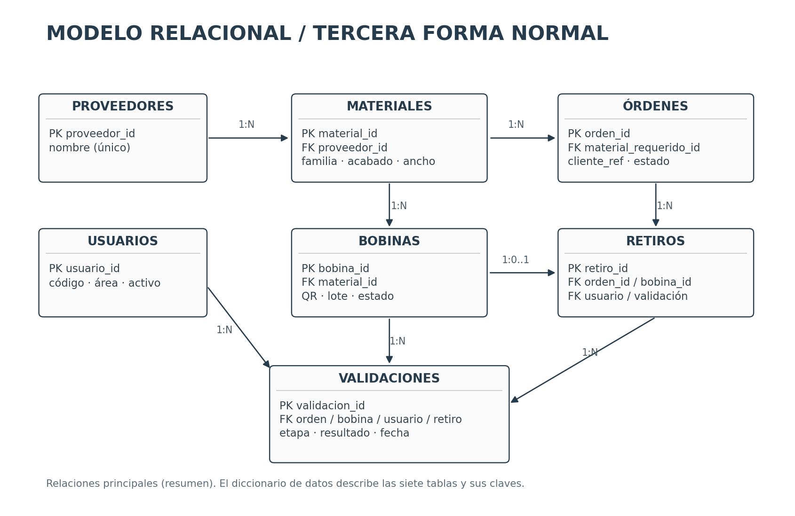

# 03. Modelo entidad-relación, reglas y normalización

## 1. Modelo lógico

Siete tablas separan las entidades estables (proveedores, materiales, usuarios, bobinas y órdenes) de los eventos operacionales (validaciones y retiros). El diseño de laboratorio tiene una bobina por retiro, pero **acepta varias bobinas para una misma orden**.

## 2. Cardinalidades

- Un **proveedor** tiene varios materiales (1:N); cada material referencia a un proveedor.
- Un **material** está asociado a varias bobinas y puede ser requerido por distintas órdenes (1:N en ambos casos).
- Una **orden** puede tener varios retiros y muchas validaciones (1:N).
- Una **bobina** puede presentar varias validaciones históricas; solo se admite un retiro autorizado por bobina en el prototipo (1:0..1), por la restricción `UNIQUE(bobina_id)`.
- Un **usuario** es responsable de muchos eventos o retiros (1:N).
- Un **retiro** tiene una validación correcta de bodega, referenciada por `validacion_bodega_id`, y cero o más intentos de validación en producción.

## 3. Diccionario de entidades

| Tabla | Clave primaria | Claves foráneas | Atributos y reglas |
|---|---|---|---|
| `proveedores` | `proveedor_id` | — | `nombre` único, obligatorio |
| `materiales` | `material_id` | `proveedor_id` | `codigo`, familia, acabado, ancho positivo, activo |
| `usuarios` | `usuario_id` | — | `codigo`, nombre de demostración, área y vigencia |
| `bobinas` | `bobina_id` | `material_id` | `codigo_qr` único; lote, metros iniciales y estado |
| `ordenes_produccion` | `orden_id` | `material_requerido_id` | `codigo` único; cliente de referencia, cantidad, fecha y estado |
| `validaciones` | `validacion_id` | `orden_id`, `bobina_id`, `usuario_id`, `retiro_id` | Etapa, resultado y momento del intento |
| `retiros` | `retiro_id` | `orden_id`, `bobina_id`, `usuario_bodega_id`, `validacion_bodega_id` | Fecha y estado; exige validación previa |

Los QR solo transportan un **identificador de bobina**. Características técnicas, lote y proveedor se consultan en tablas relacionadas, evitando información desactualizada impresa en el código.

## 4. Justificación de 3FN

**Primera forma normal:** los atributos son indivisibles en el alcance del modelo: una fila de validación guarda una orden, un usuario, una bobina, una etapa y un resultado. No se incrustan listas de materiales en una orden.

**Segunda forma normal:** todas las tablas usan claves primarias simples; los atributos dependen de la fila identificada por cada PK, no de una parte de una clave compuesta. La unicidad de ciertos códigos de negocio se expresa mediante restricciones separadas.

**Tercera forma normal:** nombres de proveedores, atributos de materiales y nombres/áreas de usuarios permanecen en sus propias entidades. Una bobina solo referencia a su material y una orden al material requerido. Por ello, modificar el proveedor no obliga a editar cada bobina, ni cambiar la clasificación de un material exige modificar cada evento de retiro. La descripción de los objetos y la historia de sus movimientos están separadas.

Los estados de bobina y retiro son atributos del ciclo operativo y se actualizan mediante disparadores. No se utilizan como duplicado del nombre de material o proveedor. Se optó por conservarlos, en lugar de recalcularlos cada vez desde el historial, para simplificar las consultas de seguimiento. Si el sistema se integrara en producción habría que controlar rigurosamente los cambios de estado, las anulaciones y las devoluciones.

## 5. Integridad adicional

- PK, FK y `UNIQUE` previenen referencias huérfanas y duplicados de códigos.
- `CHECK` impide cantidades negativas y valores de estado fuera del catálogo.
- Disparadores impiden declarar una coincidencia falsa, confirmar sin segunda lectura o crear retiros sin una validación correcta.
- La relación orden → retiros es 1:N; la relación bobina → retiros es 1:0..1. Se admite dividir una orden en varias bobinas, aunque no consumos parciales de una misma bobina.

## 6. Decisiones pendientes de un despliegue real

No se incorporaron reservas simultáneas, metros consumidos, devoluciones, devoluciones parciales, reglas para reutilización de bobinas, historial de cambios administrativos, perfiles autenticados ni sincronización con el inventario existente. Son ampliaciones necesarias antes de interpretar este esquema como un sistema productivo completo.
